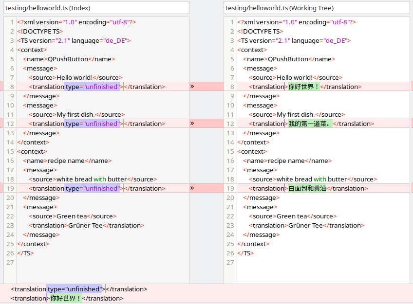

# CuteLingoExpress

[](https://github.com/marcelpetrick/CuteLingoExpress/actions/workflows/local-pipeline.yml)
[](https://github.com/marcelpetrick/CuteLingoExpress/actions/workflows/release.yml)
[](https://github.com/marcelpetrick/CuteLingoExpress/releases/latest)
[](LICENSE)
[](https://www.python.org/)
[](#qt-ts-invocation)
[](#optional-lvgl-yaml-invocation)
[](#software-quality)
[](#software-quality)

CuteLingoExpress is primarily a tool for translating Qt `.ts` files during internationalization work. It automates the translation process by letting you specify the source and target language and quickly preview how translated layouts will look. This is useful for checking whether an app's interface works well in another language before involving native speakers for final review.

As an optional side feature, the same application can translate string values in LVGL-style YAML files while preserving their keys, hierarchy, comments, quotes, block scalars, and non-string values. YAML support is deliberately kept outside the default installation so the core Qt TS workflow remains lightweight.

**Author: Marcel Petrick <mail@marcelpetrick.it>**

**Note: project is generated with AI.**

**License: GPL-3.0-only, as declared in the package metadata. See [`LICENSE`](LICENSE).**

  
The logo consists of a cute (Qt..) snake (Python) circling a upper-case TS (symbolising the tanslation files).

## Motivation
Internationalization plays a crucial role in developing successful applications, as not all customers are comfortable with English. Qt provides a comprehensive ecosystem for handling internationalization, including language support in C++/Qt and tools such as `lupdate`, `lrelease` and `Linguist`. One thing that was missing was a quick way to automatically generate translations and review them in the context of an app's layouts. CuteLingoExpress fills that gap by automating the translation process and giving developers a convenient way to assess layout compatibility.

# Usage

## Setup
The [latest GitHub release](https://github.com/marcelpetrick/CuteLingoExpress/releases/latest) provides standalone x86-64 downloads with Qt TS and LVGL YAML support. On Linux, mark the AppImage executable and run it from a terminal. On Windows, extract the entire ZIP and run `cutelingoexpress.exe` from its extracted folder.

### Python installation

The project requires Python 3.12 or newer. Dependencies are pinned in [`pyproject.toml`](pyproject.toml), including `translators==6.0.4`; there are no `requirements.txt` files.

For local development of the core Qt TS workflow, create the virtual environment and install the package with development dependencies:
```sh
python3 -m venv .venv
.venv/bin/python -m pip install -e ".[dev]"
```

To enable the optional LVGL YAML mode in the same environment, install the `yaml` extra:
```sh
.venv/bin/python -m pip install -e ".[yaml]"
```

Contributors running the complete test and quality pipeline should install both extras:
```sh
.venv/bin/python -m pip install -e ".[dev,yaml]"
```

For normal local use without development tools, install the package into your active environment:
```sh
python -m pip install .
```

## Qt TS invocation
CuteLingoExpress accepts the path to the `.ts` file and, optionally, the source and target language codes. Explicit language arguments take precedence, but a target that conflicts with the catalog’s `language` metadata is rejected to prevent mixed-language output. When omitted, it reads `sourcelanguage` and `language` from the Qt TS root element, then tries filename suffixes such as `_en_de.ts` for a source-target pair or `_de.ts` and `_zh_CN.ts` for a target. If no source language is declared, Google and Bing detect it automatically. For more information about supported language codes, refer to the `translators` documentation at https://pypi.org/project/translators/. Translation requests with an explicit or inferred source use the full `google -> bing -> myMemory` fallback chain; automatically detected sources use `google -> bing`. Every backend has a per-request timeout.

After setup or a successful local pipeline run, use the installed command from `.venv`:
```shell
.venv/bin/cutelingoexpress testing/keepassxc_de.ts
.venv/bin/cutelingoexpress testing/numerus.ts en de
.venv/bin/cutelingoexpress testing/helloworld.ts en de
.venv/bin/cutelingoexpress --version
```

Running the source file directly still works when you are in the repository:
```shell
.venv/bin/python auto_trans.py testing/helloworld.ts en de
```

## Optional LVGL YAML invocation

Invoke the side feature explicitly with `--lvgl-yaml`, followed by the YAML file and source and target language codes:
```shell
.venv/bin/cutelingoexpress --lvgl-yaml testing/lvgl/Template-en_US.yaml en de
```

The source file is never modified. A sibling output is written with the target language appended to its name; the example above creates `testing/lvgl/Template-en_US_de.yaml`. Both `.yaml` and `.yml` inputs are accepted.

Only YAML values are translated. Mapping keys, nesting, comments, scalar quote and block styles, anchors, lists, numbers, booleans, and null values are preserved through `ruamel.yaml` round-trip processing. Translation calls use the same timeout and backend fallback behavior as Qt TS translation. If an anchored string is shared by a key and values, the key keeps its original anchor and the translated values share a new, uniquely named anchor.

## Versioning
CuteLingoExpress follows Semantic Versioning (`MAJOR.MINOR.PATCH`).  
Current application version is v0.4.1. GitHub Releases publishes each tagged version.

The version is actively used across the lifecycle:
* The single source of truth is [`version.py`](version.py).
* Runtime code imports that version and prints it as the very first console output on startup.
* Build metadata reads the same value through [`pyproject.toml`](pyproject.toml), so packaging and runtime stay aligned.
* `cutelingoexpress --version` provides a lightweight way to surface the current release during debugging and support.
* Runtime, build-system, development, and optional YAML dependencies are pinned in [`pyproject.toml`](pyproject.toml). The `yaml` extra is not installed for normal Qt TS use.

## Local pipeline

On x86-64 Linux, install the Qt Linguist tools pinned in [`.qt-version`](.qt-version) before the first pipeline run. The installer uses `curl` and `bsdtar` and defaults to `~/Qt`. Set `QT_ROOT_DIR` for both commands to use another location.

```sh
./packaging/install-qt.sh
./localPipeline.sh --noRun
```

The pipeline creates or reuses `.venv` with Python 3.12 or newer, installs the project with development and optional YAML dependencies, checks the runtime version, runs Pylint and the offline unit tests with coverage, and compiles the TS fixtures with Qt's `lrelease`. It generates `htmlcov/index.html`, builds source and wheel distributions, installs the freshly built wheel, and verifies the installed package version.

After the pipeline succeeds, the built wheel is installed into `.venv`, so real translation work can be started with:
```sh
.venv/bin/cutelingoexpress path/to/file.ts source_lang target_lang
```

The pipeline prints a PASS/FAIL summary for each mandatory stage. A failed stage
returns a nonzero exit status and prevents later packaging stages from running.

## Handling errors
* Unfinished messages with length variants are rejected before replacement; translate those messages manually. Messages with missing or blank sources are skipped and remain unfinished.
* The tool uses unofficial web translation backends through `translators`, so backend availability can still change. If one backend fails, CuteLingoExpress automatically tries the next backend in the configured fallback chain.
* Rate limits and regional backend availability can still affect long runs. If all configured backends fail, the command stops with the collected backend errors.
* If `--lvgl-yaml` is requested without the optional parser, the command reports the exact `cutelingoexpress[yaml]` installation command. Normal Qt TS translation does not import or require the YAML parser.

## Checking results
* To assess the translated content, it is recommended to use the diff command from your preferred version-control system. This allows you to compare the changes made in the `.ts` file and verify the accuracy of the translations.
  

### Additional Features
* CuteLingoExpress preserves Qt TS numerus form slots while filling unfinished plural translations, so language-specific plural form counts remain intact.
* Optional LVGL YAML translation writes a separate target file and round-trips comments and scalar styles without translating schema keys.
* During development, a key goal was to preserve the original file structure to minimize the differences when comparing versions. This approach ensures that the changes made during translation are easily identifiable.

## Software quality

The 0.4.0 validation snapshot has 76 passing automated tests, 98.58% combined
statement and branch coverage, and Pylint 10/10. The coverage and Pylint badges
show that snapshot; workflow and release badges update from GitHub.

Run the complete gate with `./localPipeline.sh`. To run individual checks:

```sh
.venv/bin/python -m unittest
.venv/bin/python -m coverage run -m unittest
.venv/bin/python -m coverage report -m
.venv/bin/python -m coverage html
```

The default suite skips four opt-in tests that contact real translation services.
After the pipeline installs the built wheel, run them with:

```sh
CUTELINGOEXPRESS_LIVE_TESTS=1 .venv/bin/python -m unittest -v test_live_translation
```

These tests invoke the installed command outside the source tree on temporary
copies of all three TS fixtures and the full 154-string LVGL template. They check
source preservation, finished translations, Qt placeholders and plural slots,
YAML keys, value types, scalar styles, and comments. If Qt's `lrelease` is
available, the translated TS files are also compiled to `.qm` files.
CLI logs remain in `/tmp/cle-live-validation`; set
`CUTELINGOEXPRESS_LIVE_OUTPUT` to use another directory. Backend availability and
rate limits can affect these live checks, and translation wording still needs
human review.

# Naming?
* The name "CuteLingoExpress" combines elements from different aspects of the tool to convey its purpose and characteristics. It blends "cute" from Qt, "lingo" representing the language translation aspect, and "express" to emphasize the tool's speed and efficiency in translating Qt content. This name reflects the tool's goal of delivering delightful and rapid translations while capturing the essence of the Qt framework.
* The development of CuteLingoExpress involved applying design-thinking methods and using GPT to refine the translation workflow and overall user experience.

## License
CuteLingoExpress is licensed under the GNU General Public License v3.0 only (`GPL-3.0-only`). See [`LICENSE`](LICENSE).
