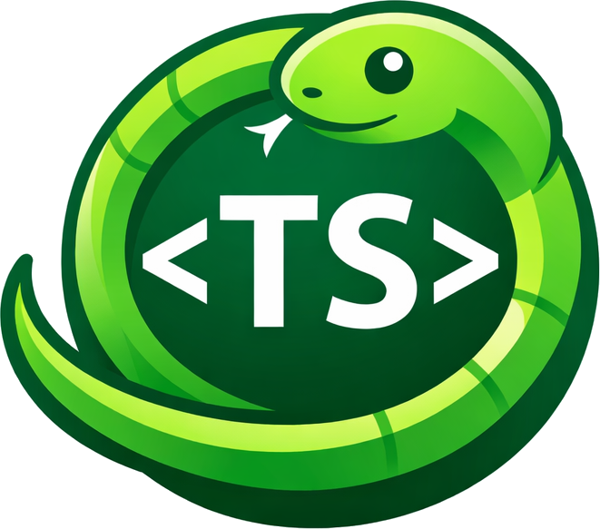

# CuteLingoExpress

[](https://github.com/marcelpetrick/CuteLingoExpress/actions/workflows/local-pipeline.yml)
[](https://github.com/marcelpetrick/CuteLingoExpress/actions/workflows/release.yml)

CuteLingoExpress is primarily a tool for translating Qt `.ts` files during internationalization work. It automates the translation process by letting you specify the source and target language and quickly preview how translated layouts will look. This is useful for checking whether an app's interface works well in another language before involving native speakers for final review.

As an optional side feature, the same application can translate string values in LVGL-style YAML files while preserving their keys, hierarchy, comments, quotes, block scalars, and non-string values. YAML support is deliberately kept outside the default installation so the core Qt TS workflow remains lightweight.

**Author: Marcel Petrick <mail@marcelpetrick.it>**

**Note: projected is generated with AI.**

**License: GPLv3 or later. See `LICENSE`.**

  
The logo consists of a cute (Qt..) snake (Python) circling a upper-case TS (symbolising the tanslation files).

## Motivation
Internationalization plays a crucial role in developing successful applications, as not all customers are comfortable with English. Qt provides a comprehensive ecosystem for handling internationalization, including language support in C++/Qt and tools such as `lupdate`, `release` and `Linguist`. One thing that was missing was a quick way to automatically generate translations and review them in the context of an app's layouts. CuteLingoExpress fills that gap by automating the translation process and giving developers a convenient way to assess layout compatibility.

# Usage

## Setup
The project requires Python 3.12 or newer. Dependencies are pinned in [`pyproject.toml`](pyproject.toml), including `translators==6.0.4`; there are no `requirements.txt` files.

For local development of the core Qt TS workflow, create the virtual environment and install the package with development dependencies:
```sh
python3 -m venv .venv
.venv/bin/python -m pip install -e ".[dev]"
```

To enable the optional LVGL YAML mode, install the `yaml` extra:
```sh
python -m pip install -e ".[yaml]"
```

Contributors running the complete test and quality pipeline should install both extras:
```sh
.venv/bin/python -m pip install -e ".[dev,yaml]"
```

For normal local use without development tools, install the package into your active environment:
```sh
python -m pip install .
```

## Qt TS invocation
CuteLingoExpress accepts the path to the `.ts` file and, optionally, the source and target language codes. Explicit language arguments take precedence. When omitted, it reads `sourcelanguage` and `language` from the Qt TS root element, then tries filename suffixes such as `_en_de.ts` for a source-target pair or `_de.ts` and `_zh_CN.ts` for a target. If no source language is declared, Google and Bing detect it automatically. For more information about supported language codes, refer to the `translators` documentation at https://pypi.org/project/translators/. Translation requests with an explicit or inferred source use the full `google -> bing -> myMemory` fallback chain; automatically detected sources use `google -> bing`. Every backend has a per-request timeout.

After setup or a successful local pipeline run, use the installed command from `.venv`:
```shell
.venv/bin/cutelingoexpress testing/keepassxc_de.ts
.venv/bin/cutelingoexpress testing/numerus.ts de cn
.venv/bin/cutelingoexpress testing/helloworld.ts en cn
.venv/bin/cutelingoexpress --version
```

Running the source file directly still works when you are in the repository:
```shell
.venv/bin/python auto_trans.py testing/helloworld.ts en cn
```

## Optional LVGL YAML invocation

Invoke the side feature explicitly with `--lvgl-yaml`, followed by the YAML file and source and target language codes:
```shell
.venv/bin/cutelingoexpress --lvgl-yaml testing/lvgl/Template-en_US.yaml en de
```

The source file is never modified. A sibling output is written with the target language appended to its name; the example above creates `testing/lvgl/Template-en_US_de.yaml`. Both `.yaml` and `.yml` inputs are accepted.

Only YAML values are translated. Mapping keys, nesting, comments, scalar quote and block styles, anchors, lists, numbers, booleans, and null values are preserved through `ruamel.yaml` round-trip processing. Translation calls use the same timeout and backend fallback behavior as Qt TS translation.

Upon execution, the tool performs the translations and updates the `.ts` file in place. An example of the output could look like this:
```shell
$ .venv/bin/cutelingoexpress testing/helloworld.ts en cn
CuteLingoExpress 0.2.15
Using Germany server backend.
translateString[google]: 0.5s : Hello world! -> 你好世界！ (en -> cn)
translateString[google]: 1.0s : My first dish. -> 我的第一道菜。 (en -> cn)
translateString[google]: 1.5s : white bread with butter -> 白面包和黄油 (en -> cn)
TS file transformed successfully.
Overall runtime: 3.1s
```

## Versioning
CuteLingoExpress follows Semantic Versioning (`MAJOR.MINOR.PATCH`).  
Current application version is v0.2.15. The release workflow creates the matching Git tag.

The version is actively used across the lifecycle:
* The single source of truth is [`version.py`](version.py).
* Runtime code imports that version and prints it as the very first console output on startup.
* Build metadata reads the same value through [`pyproject.toml`](pyproject.toml), so packaging and runtime stay aligned.
* `cutelingoexpress --version` provides a lightweight way to surface the current release during debugging and support.
* Runtime, build-system, development, and optional YAML dependencies are pinned in [`pyproject.toml`](pyproject.toml). The `yaml` extra is not installed for normal Qt TS use.

## Local pipeline
Run the complete local validation pipeline with:
```sh
./localPipeline.sh
```

The pipeline creates or reuses `.venv` with Python 3.12 or newer, installs the project with development and optional YAML dependencies, checks the runtime version, runs Pylint, runs all Qt TS and YAML tests with coverage, generates `htmlcov/index.html`, builds source and wheel distributions, installs the freshly built wheel, and verifies the installed package version.

`--noRun` is accepted for compatibility with other projects, but CuteLingoExpress has no long-running application launch stage:
```sh
./localPipeline.sh --noRun
```

After the pipeline succeeds, the built wheel is installed into `.venv`, so real translation work can be started with:
```sh
.venv/bin/cutelingoexpress path/to/file.ts source_lang target_lang
```

The final section of a successful pipeline run should look like this:
```text
========== Local Pipeline Summary ==========
Virtualenv       : PASS .venv is available
Python           : PASS Python 3.14.6
Dependencies     : PASS Editable install with dev dependencies completed
Version          : PASS cutelingoexpress --version completed
Pylint           : PASS 10.00/10 (100%)
Tests+Coverage   : PASS Ran 43 tests in 0.024s; TOTAL             194      0     50      0  100.00%
Clean Build      : PASS Stale package artifacts removed
Package Build    : PASS Successfully built cutelingoexpress-0.2.15.tar.gz and cutelingoexpress-0.2.15-py3-none-any.whl
Wheel            : PASS cutelingoexpress-0.2.15-py3-none-any.whl
Wheel Install    : PASS Built wheel installed into .venv
Import Check     : PASS 0.2.15
============================================
```

## Handling errors
* The tool uses unofficial web translation backends through `translators`, so backend availability can still change. If one backend fails, CuteLingoExpress automatically tries the next backend in the configured fallback chain.
* Rate limits and regional backend availability can still affect long runs. If all configured backends fail, the command stops with the collected backend errors.
* If `--lvgl-yaml` is requested without the optional parser, the command reports the exact `cutelingoexpress[yaml]` installation command. Normal Qt TS translation does not import or require the YAML parser.

## Checking results
* To assess the translated content, it is recommended to use the diff command from your preferred version-control system. This allows you to compare the changes made in the `.ts` file and verify the accuracy of the translations.
  

### Additional Features
* CuteLingoExpress preserves Qt TS numerus form slots while filling unfinished plural translations, so language-specific plural form counts remain intact.
* Optional LVGL YAML translation writes a separate target file and round-trips comments and scalar styles without translating schema keys.
* During development, a key goal was to preserve the original file structure to minimize the differences when comparing versions. This approach ensures that the changes made during translation are easily identifiable.

## Software quality
### Unit testing
* Please run the tests in `test_auto_trans.py` and `test_auto_trans_yaml.py` to check for regressions.
```sh
python test_auto_trans.py                                                                                                     1 ✘  CuteLingoExpress  
................TS file transformed successfully.
.TS file transformed successfully.
.TS file transformed successfully.
.TS file transformed successfully.
.TS file transformed successfully.
.TS file transformed successfully.
.translateString[google]: 0.0s : Hello world -> 你好世界 (en -> cn)
.translateString[bing]: 0.0s : Hello world -> 你好世界 (en -> cn)
......
----------------------------------------------------------------------
Ran 43 tests in 0.024s

OK
```

* To generate coverage for every test, install the development and YAML dependencies with `python -m pip install -e ".[dev,yaml]"`.
* Run `python -m coverage run -m unittest` to execute the full test suite with coverage collection.
* Run `python -m coverage report -m` to print a line-by-line coverage summary in the terminal.
* Run `python -m coverage html` to generate an HTML report in `htmlcov/index.html`.
```sh
python -m coverage report -m
Name            Stmts   Miss Branch BrPart    Cover   Missing
-------------------------------------------------------------
auto_trans.py     189      0     50      0  100.00%
version.py          5      0      0      0  100.00%
-------------------------------------------------------------
TOTAL             194      0     50      0  100.00%
```

### Linting
* `pylint` gives it a rating of 10.00/10 for v0.2.15.
* Run `python -m pylint auto_trans.py auto_trans_yaml.py test_auto_trans.py test_auto_trans_yaml.py version.py` to lint the Python modules.
```sh
python -m pylint auto_trans.py test_auto_trans.py version.py                                                               ✔  CuteLingoExpress  

--------------------------------------------------------------------
Your code has been rated at 10.00/10 (previous run: 10.00/10, +0.00)
```

# Naming?
* The name "CuteLingoExpress" combines elements from different aspects of the tool to convey its purpose and characteristics. It blends "cute" from Qt, "lingo" representing the language translation aspect, and "express" to emphasize the tool's speed and efficiency in translating Qt content. This name reflects the tool's goal of delivering delightful and rapid translations while capturing the essence of the Qt framework.
* The development of CuteLingoExpress involved applying design-thinking methods and using GPT to refine the translation workflow and overall user experience.

## License
CuteLingoExpress is licensed under the GNU General Public License v3.0. See [`LICENSE`](LICENSE).
